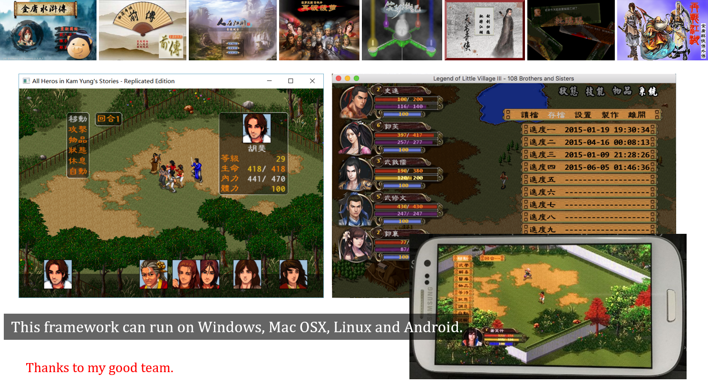

# 《金庸群侠传》pascal复刻版




原DOS下面的经典游戏《金庸群侠传》pascal复刻版。

通过改变工作目录的方式，可以运行大部分MOD。

## cpp版本

**为区别于全新的kys-cpp，本项目的AI移植版命名为kys-pascal-c。**

因为还是有老玩家有兴趣玩这些古老的MOD，但是pascal确实太不方便了，所以就有了用AI翻译一个cpp版本的想法。

与后来发布的全新的kys-cpp不同，这个版本只是AI按照1:1的方式将pascal代码转换成c++。所以可以认为相当于C+class+stl，基本是面向过程的代码组织，没有使用什么设计模式。除了怀旧，也不建议研究。

目前所有流程都已经完成，基本可以正常游戏，也可以支持50指令，可能有潜在bug。

如果你真的想研究一些金庸群侠传MOD的技术，我仍旧推荐你去研究kys-cpp，因为它的设计更合理，代码更清晰，性能更好。

就本工程而言，cpp的工具链更完备，所以如果以后要加新功能，会在cpp版本上进行开发。如果发现了功能缺失，也可以让AI很快地移植过来。

## 如何编译

### 资源文件

首先下载游戏本体，其中包含了Windows版本的exe文件和dll文件以及资源文件：<https://pan.baidu.com/s/1nv9R5rz>。

注意大部分是商业性质的素材，禁止使用其盈利。

### pascal版本

SDL3的pas文件请从<https://github.com/PascalGameDevelopment/SDL3-for-Pascal>获取，并在Lazarus工程所在目录下创建一个lib目录放置。其他外部库的文件均已经自带。

安装Lazarus，如果你对命令行熟悉可以只安装fpc，推荐使用最新版。CodeTyphon也可以。

使用Delphi社区版也可以编译，但不推荐。

不在Windows下面编译则需要安装运行库，用brew（Mac），apt-get（Ubuntu）之类安装sdl3，sdl3-ttf，sdl3-mixer，lua等相关sdl库。
如果lua库不能自动安装，则需要自己编译。

检查lua52.pas的开头部分指定的库文件名字，如果与现有的不同则修改。

### 关于pascal版的Android版本

以下是配置指引，但是由于pascal的工具链不太完善，Lazarus的官方版的Android编译非常复杂，用CodeTyphon也只简单一点点。除此之外，还需下载对应系统的运行库，供链接时使用。因此不再建议研究。

在Android目录里包含一个批处理文件，在安装了Android Studio和CodeTyphon后可以用于编译出so文件和打包apk。

SDL一般是在java部分调用SDL_main这个函数，可以查找以下两个部分，修改对应的地方即可。

```java
    protected String getMainFunction() {
        return "Run";    //原为SDL_main
    }

    protected String[] getLibraries() {
        return new String[] {
            "SDL3",
            ///...
            "kys"    //原为main
        };
    }
```

如果跑不起来建议让AI来调试。

### cpp版本

建议使用Visual Studio打开sln文件直接编译，缺失的文件在作者的另一个项目mlcc里面。其他用到的开源库请使用vcpkg编译，或者从SDL的官网下载预编译版本。

因为使用到midi功能，SDL3-mixer加上fluidSynth的支持，如需要播放mp3最好再加上mpg123，以上都建议使用vcpkg。

### 原生 MCP 模式

CMake 也可构建 `kys_mcp`，通过 stdio MCP 操作原生事件、物品、队伍、场景与战斗逻辑，不创建图形窗口。
苍龙逐日的修复与规则说明见[苍龙逐日](docs/苍龙逐日.md)。

MCP 通过 `--mod` 选择模组，`--save-dir` 指定独立存档目录；工具列表自带操作说明。
构建时可用 `KYS_BUILD_MCP` 开关控制 MCP。
规则由 `[rules]` 配置选择，`profile=dragon_dos12` 启用苍龙 1.2 原版数值及[已核验的程序修复](docs/苍龙逐日.md)，保留原版武功伤害公式；省略或选择 `profile=remake` 则保持复刻规则。


### 网页版本

安装 Emscripten、vcpkg、CMake、Ninja 和 Python，在仓库的 `mlcc` 目录放置 [mlcc](https://github.com/scarsty/mlcc)，并设置 `EMSDK` 和 `VCPKG_ROOT`。准备完整游戏资源后，运行 `./web/build.ps1 -GameData <资源目录>`，输出位于 `web/dist`。Python 依赖可通过 `python -m pip install -r web/requirements.txt` 安装；工具链路径可通过构建脚本参数指定。

## 字符串的处理

在Delphi和Lazarus中默认的字符串编码不同，但是可以强制设置。故目前在pascal版本中和cpp版本中都强制设置为utf-8编码，

即代码中的字串运算和显示仅使用utf-8，存档和资源维持Big5编码。不再使用widestring和widechar。

## 注意

除了用于怀旧和运行较老的mod之外，均不建议使用。

很多设计现在来看很冗余，导致想增加一些功能非常复杂，因此也不推荐深入研究此源码。

例如：屏幕的刷新经常停止，或者只刷新部分区域。以及大量功能分散在各种模块中，且互相调用非常混乱，并用全局变量传递消息。

建议改用c++版：<https://github.com/scarsty/kys-cpp>。

